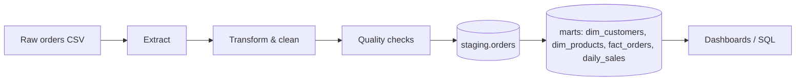

# E-commerce Batch ETL Pipeline

End-to-end batch ETL for e-commerce orders: raw CSV → cleaned staging in Postgres → modelled marts for reporting, with data quality checks and Airflow orchestration.

Author: Karan Kumar Ravella

## What it does

- **Extract** — reads raw orders CSVs and validates the schema up front.
- **Transform** — cleans and validates rows (dates, quantities, prices, emails, status), de-duplicates order lines, and computes `line_total`.
- **Load** — full-refresh load into `staging.orders` in Postgres, then rebuilds the marts.
- **Quality** — row counts, null checks, uniqueness, non-negative amounts, and freshness. A failed check fails the run.
- **Model** — staging and marts in dbt form (`models/`), plus plain-Postgres SQL in `sql/` for the Python loader.

## Architecture



```
CSV files ──▶ extract.py ──▶ transform.py ──▶ quality.py ──▶ Postgres staging
                                                                │
                                                    ┌───────────┴───────────┐
                                                    ▼                       ▼
                                          models/staging/         models/marts/
                                          (dbt views)             (dbt tables)
```

## Tech stack

Python 3.12, pandas, Postgres 16, psycopg2, Airflow 2.9, dbt-style SQL models, Docker / Docker Compose, pytest.

## Project structure

```
.
├── src/etl/                  # Python package: config, extract, transform, load, quality, pipeline, db
│   ├── config.py             # Settings from environment variables
│   ├── extract.py            # CSV reading and schema validation
│   ├── transform.py          # Cleaning, validation, enrichment
│   ├── load.py               # Staging load and mart rebuild
│   ├── quality.py            # Data quality checks
│   ├── pipeline.py           # CLI runner: extract → transform → load → quality
│   └── db.py                 # Postgres connection and SQL-file execution
├── dags/etl_pipeline.py      # Airflow DAG (extract → transform → load → quality → build marts)
├── models/
│   ├── staging/              # stg_orders, stg_customers (dbt)
│   └── marts/                # dim_customers, dim_products, fact_orders, daily_sales (dbt)
├── sql/
│   ├── schema.sql            # Postgres DDL for staging and marts
│   ├── marts_build.sql       # Plain-Postgres mart rebuild used by the loader
│   └── quality_checks.sql    # Warehouse-level checks (each query should return 0 rows)
├── data/sample/orders.csv    # 20-row sample dataset
├── scripts/generate_data.py  # Synthetic data generator (500 rows by default)
├── tests/                    # pytest: transform, extract, quality, end-to-end dry run
├── Dockerfile
├── docker-compose.yml        # Postgres + ETL app; Airflow under the `airflow` profile
├── requirements.txt
├── requirements-airflow.txt
└── .env.example
```

## Data model

| Table | Grain | Description |
|---|---|---|
| `staging.orders` | one row per order line | Cleaned raw orders, full refresh per run |
| `marts.dim_customers` | one row per customer | Lifetime orders and spend |
| `marts.dim_products` | one row per product | Lifetime quantity and revenue |
| `marts.fact_orders` | one row per order line | Cleaned order lines for reporting |
| `marts.daily_sales` | one row per day | Orders, items sold, and revenue for completed / shipped orders |

Input schema (`data/sample/orders.csv`):

`order_id, order_date, customer_id, customer_name, customer_email, product_id, product_name, category, quantity, unit_price, currency, status, region`

## Quickstart

### 1. Without a database (dry run)

```bash
python -m venv .venv
source .venv/bin/activate
pip install -r requirements.txt
python -m etl.pipeline --dry-run
```

This runs extract, transform and quality checks on `data/sample/orders.csv` with no database.

### 2. With Docker and Postgres

```bash
cp .env.example .env
docker compose up -d --build
docker compose run --rm etl python -m etl.pipeline
```

Check the results:

```bash
docker compose exec postgres psql -U etl_user -d etl_db -c "SELECT * FROM marts.daily_sales ORDER BY order_date;"
```

### 3. Generate more data

```bash
python scripts/generate_data.py --rows 500 --out data/generated
python -m etl.pipeline --orders data/generated/orders.csv --dry-run
```

## Running with Airflow

Airflow is kept out of `requirements.txt` so the core pipeline stays light.

```bash
pip install -r requirements-airflow.txt
export PYTHONPATH=src:$PYTHONPATH
export AIRFLOW_HOME=$PWD/airflow
airflow db migrate
airflow dags list
```

Or with Docker:

```bash
docker compose --profile airflow up airflow-init
docker compose --profile airflow up -d
```

The DAG is `dags/etl_pipeline.py` (`etl_pipeline`, daily, 2 retries). It imports the same `etl` package as the CLI, so the DAG and the CLI always run the same logic.

## Running with dbt

The models in `models/` are dbt models. After the staging load:

```bash
dbt build --profiles-dir .
```

`models/staging/schema.yml` and `models/marts/schema.yml` declare `unique` and `not_null` tests for the key columns. The Python loader rebuilds the same marts from `sql/marts_build.sql`, which is the plain-Postgres equivalent of the dbt mart models.

## Tests

```bash
pytest -q
```

Tests cover transform rules (de-duplication, bad dates, zero quantities, status normalisation, line totals), extract schema validation, quality checks (empty data, duplicates, stale data), and an end-to-end dry run over the sample CSV. They need no database.

## Design decisions and trade-offs

- **Full-refresh staging, not incremental.** For a daily batch job at this scale, `TRUNCATE` + insert keeps the pipeline idempotent and easy to reason about. An incremental load with a watermark on `order_date` would be the next step if volumes grew or late-arriving rows needed handling.
- **Quality checks fail the run.** A bad batch should not silently land in the marts. Checks run on the cleaned frame before loading, and `sql/quality_checks.sql` covers the warehouse after the load.
- **One logic path for CLI and Airflow.** The DAG calls the same `etl` functions as `python -m etl.pipeline`, so a fix in one place fixes both.
- **dbt models + plain SQL.** The dbt models are the modelling contract; `sql/marts_build.sql` is the plain-Postgres equivalent the loader runs, so the pipeline works without a dbt installation.
- **Pandas for transform, Postgres for modelling.** Pandas keeps the cleaning logic testable in pure Python. Aggregation that belongs in the warehouse lives in SQL, where it is visible and versioned.
- **No credentials in the repo.** All connection settings come from environment variables; see `.env.example`.

## Limitations

- The generator produces synthetic data; real source systems usually need an API or object-store extract instead of CSV.
- The Airflow tasks use a local parquet file (`/tmp/clean_orders.parquet`) to pass data between tasks. For a distributed executor, use XCom with a small payload or an object store instead.
- `daily_sales` only counts `completed` and `shipped` orders. Cancelled and refunded orders are kept in `fact_orders` so the choice is auditable.
